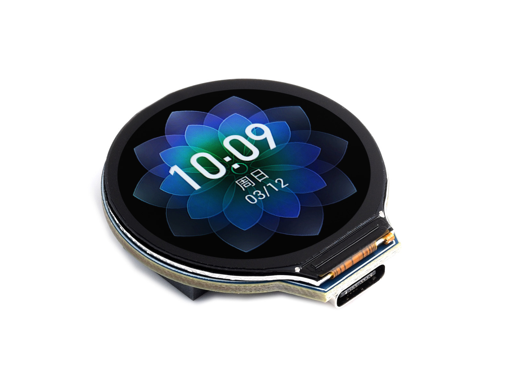

  <h1>ESP32-S3-LCD-1.28</h1>
  
<strong>ESP32-S3 development board with a 1.28-inch 240 × 240 round LCD and motion sensor</strong>

  
<strong>English</strong> | <a href="README_ZH.md">简体中文</a>

  

    
    
    
  

  

    <a href="https://www.waveshare.com/esp32-s3-lcd-1.28.htm">🛒 Product</a> &middot;
    <a href="firmware/">📦 Firmware</a> &middot;
    <a href="https://docs.espressif.com/projects/esp-idf/en/latest/esp32s3/">🧩 ESP-IDF</a> &middot;
    <a href="examples/arduino/examples/">🔧 Arduino</a> &middot;
    <a href="https://docs.waveshare.net/ESP32-S3-LCD-1.28/">📖 Documentation</a>
  

  

---

## ✨ Overview

ESP32-S3-LCD-1.28 combines an ESP32-S3 dual-core LX7 controller with a 1.28-inch 240 × 240 GC9A01 SPI LCD, QMI8658 motion sensor, CST816S touch controller and battery measurement.

| Feature | Device / interface |
| --- | --- |
| MCU | ESP32-S3 dual-core LX7, Wi-Fi and Bluetooth |
| Memory | 16 MB Flash, 2 MB PSRAM |
| Display | 1.28-inch 240 × 240 IPS LCD, GC9A01, SPI |
| Motion sensor | QMI8658, I2C |
| Touch | CST816S, I2C |

## 📦 Quick Start

1. Open an example under [`examples/arduino/examples`](examples/arduino/examples/).
2. Install Arduino-ESP32 core 4.0.0 and select `ESP32S3 Dev Module`.
3. Set Flash Size to 16MB and PSRAM to OPI PSRAM.
4. Select the board USB port and upload the sketch.
5. Reset the board if the display does not start automatically.

Factory firmware is available in [`firmware`](firmware/). Flash the `FactoryOnly` image from offset `0x0` with the procedure in the product documentation.

## 🧪 Examples

| Example | Main feature |
| --- | --- |
| [ESP32-S3-LCD-1.28-Test](examples/arduino/examples/ESP32-S3-LCD-1.28-Test/) | Draws graphics, reads QMI8658 motion data and displays battery voltage |
| [LVGL_Arduino](examples/arduino/examples/LVGL_Arduino/) | Shows LVGL graphics on the GC9A01 display |
| [LVGL_Chinese_7500_Char](examples/arduino/examples/LVGL_Chinese_7500_Char/) | Displays Chinese text with a bundled LVGL font and touch input |
| [LVGL_Chinese_Font](examples/arduino/examples/LVGL_Chinese_Font/) | Displays Chinese text with the built-in LVGL SimSun font and touch input |

MicroPython resources are kept in [`examples/micropython`](examples/micropython/).

## 🛠️ Development Environment

| Framework | Version | Examples |
| --- | --- | ---: |
| Arduino-ESP32 | `4.0.0` | 4 |

## 📚 Resources

- [Product page](https://www.waveshare.com/esp32-s3-lcd-1.28.htm)
- [Wiki](https://docs.waveshare.net/ESP32-S3-LCD-1.28/)
- [Hardware documentation](https://docs.waveshare.net/ESP32-S3-LCD-1.28/)

## 🤝 Support

- Example or repository problem: [open an issue](https://github.com/waveshareteam/ESP32-S3-LCD-1.28/issues/new/choose).
- Product usage, hardware or order questions: [Waveshare support](https://service.waveshare.com/).

## 📄 License

Apache License 2.0. See [LICENSE](LICENSE).

