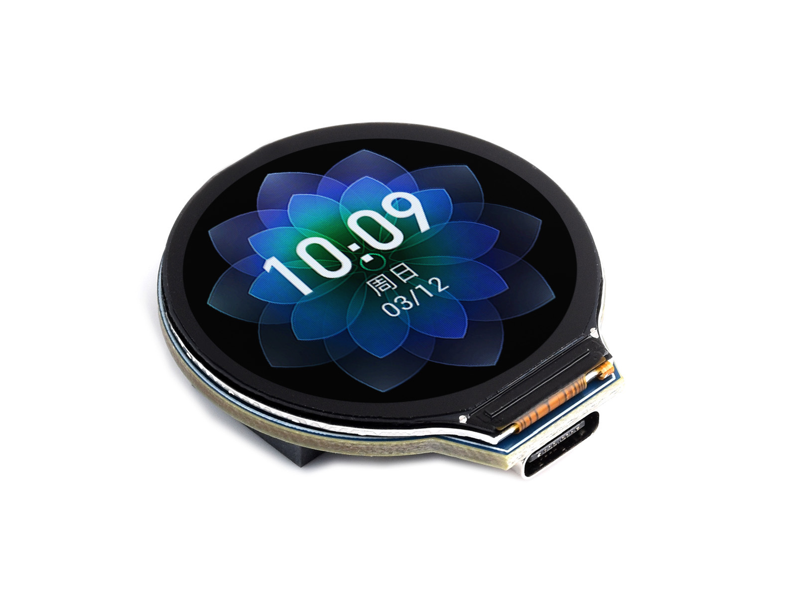

# ESP32-S3-LCD-1.28

[English](README.md)

搭载 1.28 英寸 240 × 240 圆形 LCD、QMI8658 运动传感器和 CST816S 触摸控制器的 ESP32-S3 开发板。

[产品页](https://www.waveshare.com/esp32-s3-lcd-1.28.htm) · [固件](firmware/) · [Arduino 示例](examples/arduino/examples/) · [文档](https://docs.waveshare.net/ESP32-S3-LCD-1.28/)

## ✨ 概述

ESP32-S3-LCD-1.28 集成 ESP32-S3 双核 LX7 控制器、1.28 英寸 240 × 240 GC9A01 SPI LCD、QMI8658 运动传感器、CST816S 触摸控制器和电池测量电路。

| 功能 | 器件或接口 |
| --- | --- |
| MCU | ESP32-S3 双核 LX7，支持 Wi-Fi 和蓝牙 |
| 存储器 | 16 MB Flash，2 MB PSRAM |
| 显示 | 1.28 英寸 240 × 240 IPS LCD，GC9A01，SPI |
| 运动传感器 | QMI8658，I2C |
| 触摸 | CST816S，I2C |

## 📦 快速开始

1. 打开 [`examples/arduino/examples`](examples/arduino/examples/) 中的示例。
2. 安装 Arduino-ESP32 4.0.0，并选择 `ESP32S3 Dev Module`。
3. 将 Flash Size 设置为 16MB，并启用 OPI PSRAM。
4. 选择开发板 USB 端口并上传示例。
5. 如果显示屏没有自动启动，请按下复位键。

出厂固件位于 [`firmware`](firmware/)，按照产品文档的流程从 `0x0` 烧录文件名带 `FactoryOnly` 的镜像。

## 🧪 示例

| 示例 | 主要功能 |
| --- | --- |
| [ESP32-S3-LCD-1.28-Test](examples/arduino/examples/ESP32-S3-LCD-1.28-Test/) | 绘制图形，读取 QMI8658 运动数据并显示电池电压 |
| [LVGL_Arduino](examples/arduino/examples/LVGL_Arduino/) | 在 GC9A01 显示屏上显示 LVGL 图形 |
| [LVGL_Chinese_7500_Char](examples/arduino/examples/LVGL_Chinese_7500_Char/) | 使用内置 LVGL 字体和触摸输入显示中文 |
| [LVGL_Chinese_Font](examples/arduino/examples/LVGL_Chinese_Font/) | 使用 LVGL SimSun 字体和触摸输入显示中文 |

MicroPython 资料位于 [`examples/micropython`](examples/micropython/)。

## 🛠️ 开发环境

| 开发框架 | 版本 | 示例数 |
| --- | --- | ---: |
| Arduino-ESP32 | `4.0.0` | 4 |

## 📚 资料

- [产品页](https://www.waveshare.com/esp32-s3-lcd-1.28.htm)
- [Wiki](https://docs.waveshare.net/ESP32-S3-LCD-1.28/)
- [硬件资料](https://docs.waveshare.net/ESP32-S3-LCD-1.28/)

## 🤝 支持

- 示例或仓库问题：[提交 issue](https://gitee.com/waveshare/ESP32-S3-LCD-1.28/issues)。
- 产品使用、硬件或订单问题：[微雪技术支持](https://docs.waveshare.net/ESP32-S3-LCD-1.28/Technical-Support/)。

## 📄 许可证

Apache License 2.0，详见 [LICENSE](LICENSE)。

